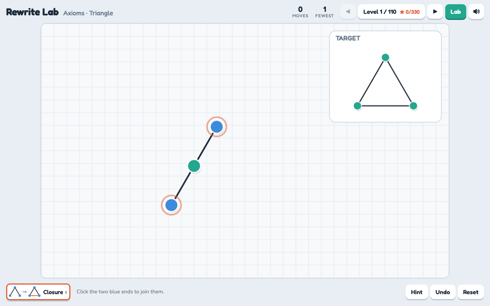

# Rewrite Lab

### ▶ [Play Rewrite Lab in your browser](https://louisvandenbruwaene.github.io/rewrite-lab/)

No install, no account: open the link and play. Click the highlighted nodes to apply a rewrite rule, until your graph matches the target. The first levels show each rule.

[](https://louisvandenbruwaene.github.io/rewrite-lab/)

Rewrite Lab: rewrite a graph into the target shape. One self-contained HTML file, no build step: open [`index.html`](index.html).

## Play on this Mac

```
./app/install_app.sh   # puts Rewrite Lab in /Applications
./app/make_icon.sh     # only needed after editing app/icon.html
```

The app opens the game in its own Brave window. The folder path is baked in, so re-run `install_app.sh` if this folder moves.

## Levels

110 levels in 9 chapters, 12 rules. Stars: 3 for the fewest moves, 2 for at most two more, 1 for any solve.

Levels 1-11, 13 and 15 are the originals. The rest come from a solver search: from each start, every reachable shape is a candidate target, kept when it is far away yet only a few move orders (at most three) reach it. Each must also have real star tiers (solutions at best, best+1 or +2, and longer), need every rule it offers, and stay under 75% dead ends. Difficulty is -log10(precision) + 0.3 x best, where precision is the chance that random play hits the target in best moves. Levels 16-100 are then picked by a player model (tools/play.cjs) rather than by that score alone: greedy colour matching must fail (it solves at most 20%), and a careful player who explores and backtracks must still get there (at least 8% of tries). Its success rate falls steadily from about 55% at level 16 to about 10% at level 100, with a wave on top, a breather opener for each new rule, and most chapter levels using the chapter's rule. Every target from level 16 on has real structure (at least 4 symmetries, often a named shape) and every start some symmetry, so the goal reads at a glance. Each chapter after Homeomorphism uses its own rule in every level, and nearby levels often share a rule set, so a chapter plays as short series. Erdős Problems (101-110) sits on top: each has exactly one best route and the careful player finds it in only 1-9% of tries.

## Rules

Each rule is named for the graph operation it is: Closure (triadic closure), Pendant, Subdivide, Contraction, Prune, Cut, Swap, Homeomorph (smoothing a two-link node), False Twin (same neighbours, not linked to the original), Complement (local complementation), Delta-Wye and Wye-Delta. Rule icons show before and after: orange is what the move adds, faint dashes are what it removes.

## How it plays

- A worker maps each level when it opens: every shape that can still reach the target and how far it is. Hints read the next move straight off that map.
- Everything sits on one screen: the board scales to the window and turns upright on a phone held upright, the move counts and sound sit in the header, and rules, hint and buttons share one fixed dock row. Enter goes on from the result card.
- Clicking is forgiving: a move that can only finish one way happens on the first click (a Star often needs one click, not three), a click with no rule chosen uses the only rule that fits there, a node's colour is its link count, and hit areas are generous.
- Each chapter opens with a short, easy level for its new rule, then a gentle practice level, before the curve climbs again.
- **The Lab** mixes fresh puzzles on the spot (Lemma, Proposition, Theorem) from the rules the player has met, under the same quality rules as the campaign.

## Tools

```
node tools/check.cjs          # fewest moves and map build time, all levels
node tools/stars.cjs 16 30    # tiers, routes, difficulty, unused rules, dead ends, for a range
node tools/play.cjs 16 30     # player model: greedy and careful success per level
```
